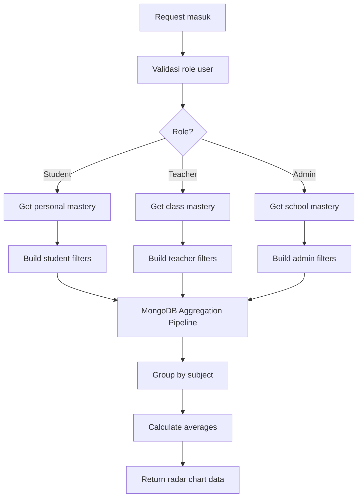

# Subject Mastery Analytics - Mekanisme Kerja & Data Requirements

## Overview

Subject Mastery Analytics adalah fitur untuk menampilkan radar chart yang menunjukkan penguasaan siswa terhadap berbagai mata pelajaran. Data kosong bisa jadi karena kekurangan data atau masalah query.

## 🔧 Mekanisme Kerja

### **1. Endpoint Path**
```
GET /api/v1/exam-analytics/subject-mastery
POST /api/v1/exam-analytics/subject-mastery
```

### **2. Flow Utama**



### **3. Role-Based Access**

#### **A. Student Role**
- ✅ Akses: Data pribadi saja
- 🔍 Filter: `student_id = current_user._id`
- 📊 Output: `StudentMasteryResponse` - data subject mastery pribadi

#### **B. Teacher Role**
- ✅ Akses: Kelas yang diajar saja
- 🔍 Filter: Berdasarkan teaching_assignments → exams → exam_sessions
- 📊 Output: `ClassMasteryResponse` - comparison antar siswa dalam kelas

#### **C. Admin Role**
- ✅ Akses: Seluruh sekolah dengan filtering fleksibel
- 🔍 Filter: Bisa filter by student, class, grade, expertise program
- 📊 Output: `SchoolMasteryResponse` - analysis school-wide

## 📋 Data Requirements

### **Data Minimum yang Diperlukan:**

#### **1. Core Collections & Documents**

```javascript
// 1. EXAM SESSIONS (yang sudah dinilai)
{
  "_id": ObjectId,
  "student_id": ObjectId,
  "exam_id": ObjectId,
  "score": 78.5,  // WAJIB: Score harus ada dan > 0
  "status": "graded", // WAJIB: Status harus "submitted" atau "graded"
  "submitted_at": ISODate
}

// 2. EXAMS (metadata ujian)
{
  "_id": ObjectId,
  "teaching_assignment_id": ObjectId, // KUNCI: Link ke mata pelajaran
  "title": "UTS Matematika",
  "academic_period_id": ObjectId // Optional tapi recommended
}

// 3. TEACHING ASSIGNMENTS (link teacher-subject-class)
{
  "_id": ObjectId,
  "teacher_id": ObjectId,
  "subject_id": ObjectId, // WAJIB: Untuk grouping by subject
  "class_id": ObjectId,   // WAJIB: Untuk class filtering
  "academic_period_id": ObjectId
}

// 4. SUBJECTS (mata pelajaran)
{
  "_id": ObjectId,
  "name": "Matematika", // WAJIB: Untuk radar chart labels
  "code": "MTK"
}

// 5. PROFILES (untuk display names)
{
  "_id": ObjectId,
  "user_id": ObjectId,
  "full_name": "Ahmad Rizki" // Untuk display name
}
```

#### **2. Data Chain Requirements**

```
exam_sessions → exams → teaching_assignments → subjects
                                           → classes
```

**Critical Path untuk Analytics:**
1. `exam_sessions.status` = "graded" dan `score` !== null
2. `exam_sessions.exam_id` → `exams._id`
3. `exams.teaching_assignment_id` → `teaching_assignments._id`
4. `teaching_assignments.subject_id` → `subjects._id`
5. `subjects.name` untuk radar chart labels

### **3. Data Quality Checks**

```javascript
// Cek 1: Apakah ada exam sessions yang graded?
db.exam_sessions.countDocuments({
  status: "graded",
  score: { $exists: true, $ne: null, $gte: 0 }
})

// Cek 2: Apakah teaching assignments terhubung dengan benar?
db.exams.aggregate([
  { $lookup: { from: "teaching_assignments", localField: "teaching_assignment_id", foreignField: "_id", as: "ta" } },
  { $match: { "ta": { $size: 0 } } },
  { $count: "orphaned_exams" }
])

// Cek 3: Apakah subjects memiliki name?
db.subjects.countDocuments({ name: { $exists: true, $ne: "" } })
```

## 🔍 Kemungkinan Penyebab Data Kosong

### **1. Missing Data**
```bash
# Check apakah ada exam sessions graded
db.exam_sessions.find({status: "graded", score: {$ne: null}}).count()
# Result: 0 → Tidak ada ujian yang sudah dinilai

# Check apakah teaching assignments ada
db.teaching_assignments.find().count() 
# Result: 0 → Tidak ada assignment teacher-subject-class

# Check apakah subjects ada
db.subjects.find().count()
# Result: 0 → Tidak ada mata pelajaran
```

### **2. Broken Data Relationships**
```bash
# Check orphaned exams (tidak ada teaching assignment)
db.exams.aggregate([
  {$lookup: {from: "teaching_assignments", localField: "teaching_assignment_id", foreignField: "_id", as: "ta"}},
  {$match: {"ta": {$size: 0}}},
  {$count: "orphaned"}
])

# Check if subjects have proper names
db.subjects.find({$or: [{name: {$exists: false}}, {name: ""}]})
```

### **3. Permission Issues**
```bash
# Student: Tidak ada exam_sessions dengan student_id mereka
db.exam_sessions.find({student_id: ObjectId("USER_ID"), status: "graded"}).count()

# Teacher: Tidak ada teaching_assignments untuk teacher
db.teaching_assignments.find({teacher_id: ObjectId("TEACHER_ID")}).count()
```

### **4. Date Filtering Issues**
- Default filter: Current academic year (July - June)
- Jika data ujian di luar range ini, akan kosong

### **5. Min Exams Threshold**
- Default `min_exams_per_subject = 1`
- Jika subject hanya ada 0 exam, tidak akan muncul

## 🧪 Debugging Steps

### **Step 1: Basic Data Check**
```javascript
// Run di MongoDB shell
db.exam_sessions.aggregate([
  {$match: {status: "graded", score: {$ne: null}}},
  {$lookup: {from: "exams", localField: "exam_id", foreignField: "_id", as: "exam"}},
  {$unwind: "$exam"},
  {$lookup: {from: "teaching_assignments", localField: "exam.teaching_assignment_id", foreignField: "_id", as: "ta"}},
  {$unwind: "$ta"},
  {$lookup: {from: "subjects", localField: "ta.subject_id", foreignField: "_id", as: "subject"}},
  {$unwind: "$subject"},
  {$group: {
    _id: "$subject.name",
    avg_score: {$avg: "$score"},
    count: {$sum: 1}
  }},
  {$sort: {_id: 1}}
])
```

### **Step 2: Role-Specific Check**

#### **Untuk Student:**
```javascript
db.exam_sessions.find({
  student_id: ObjectId("STUDENT_ID"),
  status: "graded",
  score: {$ne: null}
}).count()
```

#### **Untuk Teacher:**
```javascript
// Get teaching assignments
const teacherAssignments = db.teaching_assignments.find({
  teacher_id: ObjectId("TEACHER_ID")
}).toArray()

// Get exam IDs
const examIds = db.exams.find({
  teaching_assignment_id: {$in: teacherAssignments.map(ta => ta._id)}
}).toArray().map(e => e._id)

// Check exam sessions
db.exam_sessions.find({
  exam_id: {$in: examIds},
  status: "graded"
}).count()
```

### **Step 3: API Testing**
```bash
# Test dengan minimal parameters
curl -H "Authorization: Bearer TOKEN" \
  "http://localhost:8000/api/v1/exam-analytics/subject-mastery"

# Test dengan explicit parameters
curl -H "Authorization: Bearer TOKEN" \
  "http://localhost:8000/api/v1/exam-analytics/subject-mastery?include_zero_scores=true&min_exams_per_subject=0"
```

## 💡 Recommendations

### **1. Data Setup Minimum**
Untuk test, pastikan ada:
1. ✅ 1+ exam sessions dengan status "graded" dan score
2. ✅ Exams yang terhubung ke teaching assignments
3. ✅ Teaching assignments yang terhubung ke subjects
4. ✅ Subjects dengan nama yang jelas

### **2. Quick Fix untuk Data Kosong**
```bash
# Temporary: Lower the threshold
GET /subject-mastery?min_exams_per_subject=0&include_zero_scores=true

# Check specific date range
GET /subject-mastery?start_date=2024-01-01&end_date=2025-12-31
```

### **3. Production Setup**
1. **Ensure data integrity** dengan foreign key constraints
2. **Regular data validation** untuk check broken relationships
3. **Monitoring** untuk empty response alerts
4. **Default academic period** yang selalu ada

---

## 🔬 Quick Diagnosis Command

Jalankan script ini di MongoDB untuk diagnosis cepat:

```javascript
// Subject Mastery Analytics Data Diagnostic
print("=== SUBJECT MASTERY ANALYTICS DIAGNOSTIC ===");

print("\n1. Basic Data Counts:");
print("Exam Sessions (graded):", db.exam_sessions.countDocuments({status: "graded", score: {$ne: null}}));
print("Exams:", db.exams.countDocuments({}));
print("Teaching Assignments:", db.teaching_assignments.countDocuments({}));
print("Subjects:", db.subjects.countDocuments({}));

print("\n2. Data Quality:");
const orphanedExams = db.exams.aggregate([
  {$lookup: {from: "teaching_assignments", localField: "teaching_assignment_id", foreignField: "_id", as: "ta"}},
  {$match: {"ta": {$size: 0}}},
  {$count: "count"}
]).toArray();
print("Orphaned Exams:", orphanedExams.length > 0 ? orphanedExams[0].count : 0);

const subjectsNoName = db.subjects.countDocuments({$or: [{name: {$exists: false}}, {name: ""}]});
print("Subjects without name:", subjectsNoName);

print("\n3. Sample Subject Mastery Query:");
const sampleResult = db.exam_sessions.aggregate([
  {$match: {status: "graded", score: {$ne: null}}},
  {$lookup: {from: "exams", localField: "exam_id", foreignField: "_id", as: "exam"}},
  {$unwind: "$exam"},
  {$lookup: {from: "teaching_assignments", localField: "exam.teaching_assignment_id", foreignField: "_id", as: "ta"}},
  {$unwind: "$ta"},
  {$lookup: {from: "subjects", localField: "ta.subject_id", foreignField: "_id", as: "subject"}},
  {$unwind: "$subject"},
  {$group: {_id: "$subject.name", count: {$sum: 1}}},
  {$limit: 5}
]).toArray();

print("Sample subjects with data:", JSON.stringify(sampleResult, null, 2));
```

Silakan jalankan diagnostic script di atas untuk mengidentifikasi penyebab data kosong pada Subject Mastery Analytics Anda!
